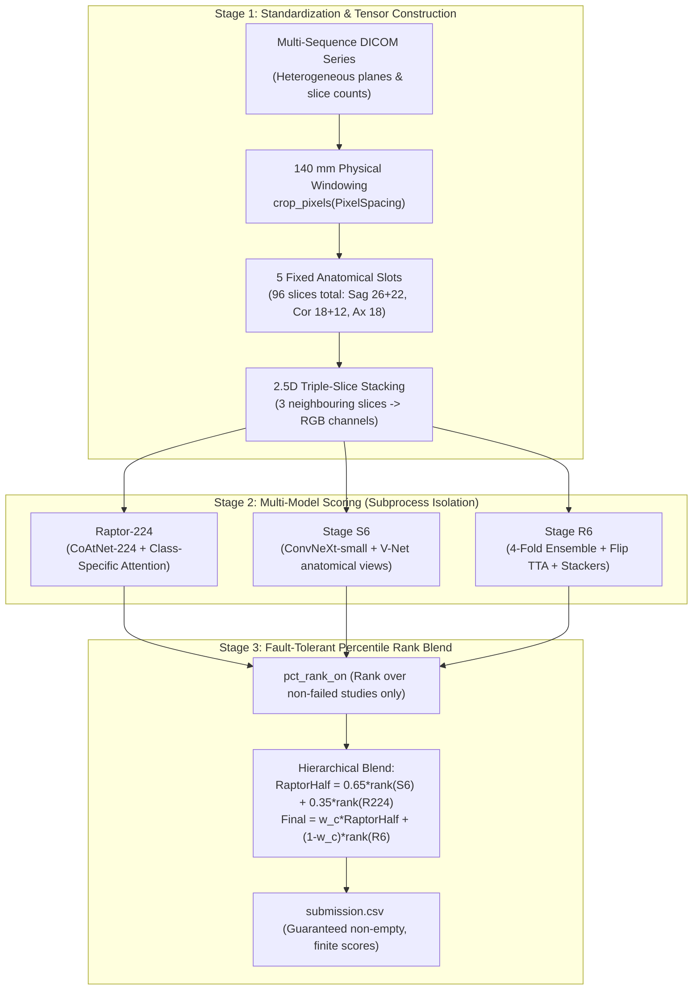

# rsna-knee-mastery

<p align="center">
  <a href="https://github.com/sunyuxiang136/rsna-knee-mastery/actions/workflows/ci.yml"></a>
  <a href="LICENSE"></a>
  
  
  
  <a href="examples/quickstart_walkthrough.ipynb"></a>
  <a href="https://www.kaggle.com/competitions/rsna-knee-abnormality-detection"></a>
</p>

<p align="center">
  <b>Tested building blocks, educational zero-GPU demo, and annotated reference code for a public Kaggle pipeline scoring twelve knee MRI findings per study.</b><br/>
  <i>End-to-End 2.5D Multi-Instance Learning, Class-Specific Attention Pooling, and Percentile-Rank Ensembling.</i>
</p>

<p align="center">
  <a href="#quick-start">Quick Start</a> •
  <a href="#the-12-target-findings">12 Target Findings</a> •
  <a href="#pipeline-architecture">Architecture</a> •
  <a href="#documentation-hub">Documentation Hub</a> •
  <a href="#中文深度导读">中文深度导读</a>
</p>

---

## What this repository is (and is not)

| Is | Is not |
|---|---|
| A **tested, type-annotated NumPy package** (`rsna_knee`) containing the core algorithmic logic: mm-based cropping, fixed-slot slice sampling, class-specific attention, and percentile-rank fusion with failure quarantine | A complete model training repository — no training loop, labels, or raw weights are hosted here |
| The **upstream reference scripts and Kaggle notebook**, preserved under [`reference/`](reference) and [`notebooks/`](notebooks) for exact reproducibility | A clinical medical device — research and educational use only |
| A **zero-GPU interactive walkthrough** runnable in seconds on any CPU or laptop ([`examples/quickstart_walkthrough.ipynb`](examples/quickstart_walkthrough.ipynb)) | Original copyright holder of `reference/` — that code belongs to its upstream Kaggle authors (see [credits](THIRD_PARTY_NOTICES.md)) |

> Reported public leaderboard scores (≈0.95 for individual components, 0.954–0.956 for the ensemble) come from comments in upstream notebooks and have not been re-verified on private test sets.

---

## Quick Start

### 1. Installation

```bash
git clone https://github.com/sunyuxiang136/rsna-knee-mastery.git
cd rsna-knee-mastery
python -m venv .venv && source .venv/bin/activate
pip install -e ".[dev]"
```

### 2. Run Tests & Interactive Demo

```bash
make test     # 22 unit tests in <0.1s (96% coverage, zero GPU required)
make demo     # Run the terminal walkthrough demonstrating all 4 core ideas
```

Or open the interactive Jupyter walkthrough in [`examples/quickstart_walkthrough.ipynb`](examples/quickstart_walkthrough.ipynb).

### 3. Python API Example

```python
import numpy as np
from rsna_knee import FINDINGS, crop_pixels, pick_indices, fuse_all

# 1. Scale-invariant physical cropping:
# Scanner spacing 0.3 mm vs 0.5 mm -> different pixel crops, identical 140 mm coverage
px_high, px_low = crop_pixels(0.3), crop_pixels(0.5)
print(f"Crop: {px_high} px (0.3mm) vs {px_low} px (0.5mm)")  # (467 px, 280 px)

# 2. Boundary-preserving slice selection across 100 slices:
slices = pick_indices(n_slices=100, k=10)
print(f"Sampled slices: {slices}")  # [2, 13, 23, ..., 97] (preserves collateral ligaments)

# 3. Percentile-rank blending across three models:
rng = np.random.default_rng(42)
pred_a, pred_b, pred_c = (rng.uniform(size=(5, 12)) for _ in range(3))
final_scores = fuse_all(pred_a, pred_b, pred_c, FINDINGS)
print(f"Fused prediction matrix shape: {final_scores.shape}")  # (5, 12)
```

---

## The 12 Target Findings

The competition requires joint prediction of 12 distinct musculoskeletal pathologies from multi-sequence MRI studies:

| Finding | Category | Clinical Scope | Diagnostic Plane | Blend Weight ($W_{\text{Raptor}}$) |
|---|---|---|---|:---:|
| **ACL** | Ligament | Anterior cruciate ligament tear | Sagittal (Fluid-sensitive) | `0.50` (default) |
| **MCL** | Ligament | Medial collateral ligament sprain / tear | Coronal (Fluid-sensitive) | `0.50` (default) |
| **Medial Meniscus** | Cartilage | Medial fibrocartilage tear | Sagittal & Coronal | `0.50` (default) |
| **Lateral Meniscus** | Cartilage | Lateral fibrocartilage tear (outer slices) | Sagittal & Coronal | `0.50` (default) |
| **Medial OA** | Joint / Bone | Osteoarthritis in medial compartment | Coronal (Anatomical) | `0.50` (user lock) |
| **Lateral OA** | Joint / Bone | Osteoarthritis in lateral compartment | Coronal (Anatomical) | `0.20` (ours dominant) |
| **PF OA** | Patellofemoral | Patellofemoral osteoarthritis | Axial & Sagittal | `0.60` (Raptor dominant) |
| **Effusion** | Fluid / Joint | Excess joint synovial effusion | Sagittal (T2/PD-FS) | `0.50` (default) |
| **Synovitis** | Inflammatory | Synovial membrane thickening | Axial & Sagittal | `0.80` (Raptor dominant) |
| **Baker's** | Cystic | Popliteal synovial fluid distension | Sagittal & Axial | `0.35` (ours dominant) |
| **Contusion** | Bone Marrow | Bone marrow edema / micro-fracture | Sagittal (Fluid-sensitive) | `0.50` (default) |
| **Fracture** | Bone Trauma | Cortical or subchondral bone fracture | Coronal & Sagittal | `0.50` (default) |

*For clinical and imaging background on each finding, see [`docs/dataset_and_labels.md`](docs/dataset_and_labels.md).*

---

## Pipeline Architecture

The pipeline processes heterogeneous DICOM studies through three decoupled stages:



### Four Foundational Innovations

1. **Physical Millimetre Cropping (`CROP_MM = 140.0`)**: Normalizes scanner spacing differences (0.3 mm vs 0.5 mm) so knees occupy identical visual fractions without discarding fine ligament pixels. → [`src/rsna_knee/geometry.py`](src/rsna_knee/geometry.py)
2. **Fixed Anatomical Slots & 2%–98% Stack Coverage**: Normalizes varying slice counts into 96 fixed layers across 5 slots, capturing outer slices where collateral ligaments and lateral meniscal horns reside. → [`src/rsna_knee/slots.py`](src/rsna_knee/slots.py)
3. **Class-Specific Attention Pooling via `einsum`**: Projects window features through independent attention weights for all 12 findings, allowing the network to select finding-specific slices. → [`src/rsna_knee/attention.py`](src/rsna_knee/attention.py)
4. **Percentile-Rank Blending with 0.5 Sentinel Quarantine**: Macro-AUC depends exclusively on relative ranking. Failed studies output sentinel `0.5` and are excluded during ranking (`pct_rank_on`), seamlessly falling back to alternate models without rank distortion. → [`src/rsna_knee/fusion.py`](src/rsna_knee/fusion.py)

*For deep architectural details, see [`docs/architecture.md`](docs/architecture.md).*

---

## Model Components & Reported Performance

| Model Stage | Architecture / View Strategy | Key Strength | Reported Public LB |
|---|---|---|:---:|
| **Stage Raptor-224** | CoAtNet-224 + 12-Class Attention Head | Rapid slice attention pooling over 5 slots | ~`0.949` |
| **Stage S6** | ConvNeXt-small + SKM-TEA V-Net Anatomical Anchor | Deep anatomical feature alignment | ~`0.950` |
| **Stage R6** | 4-Fold Ensemble + Flip TTA + Stacker Heads | Specialized effusion & Baker's cyst volume calibration | ~`0.950+` |
| **Final Blend** | Hierarchical Percentile-Rank Blend with 0.5 Quarantine | Optimal ensemble ranking across all 12 findings | **`0.954 ~ 0.956`** |

---

## Documentation Hub

| Document | Purpose |
|---|---|
| [**docs/architecture.md**](docs/architecture.md) | Technical description of pipeline stages, data flow, and fusion mathematics |
| [**docs/dataset_and_labels.md**](docs/dataset_and_labels.md) | Clinical context, DICOM multi-sequence structure, and LLM weak supervision |
| [**docs/faq.md**](docs/faq.md) | Frequently asked questions on 3D vs 2.5D, rank fusion theory, and failure defenses |
| [**docs/api_reference.md**](docs/api_reference.md) | Formal API documentation for all public functions in `rsna_knee` |
| [**docs/reproduction.md**](docs/reproduction.md) | Complete guide to reproducing the Kaggle scoring run in a T4 GPU kernel |
| [**THIRD_PARTY_NOTICES.md**](THIRD_PARTY_NOTICES.md) | Upstream credits, author attribution, and OAI dataset citation |

---

## Repository Layout

```text
rsna-knee-mastery/
├── src/rsna_knee/                 # Tested Python package (Pure NumPy, PEP 561 typed)
│   ├── __init__.py                # Public API exports
│   ├── constants.py               # 12 findings, slots, blend weights
│   ├── geometry.py                # Physical mm cropping & bounding boxes
│   ├── slots.py                   # Fixed slot sampling & slice indexing
│   ├── attention.py               # Softmax & class-specific attention pooling
│   ├── fusion.py                  # Percentile-rank blending & sentinel quarantine
│   └── py.typed                   # PEP 561 type annotation marker
├── tests/                         # Unit tests (pytest, 96% coverage)
│   └── test_core.py               # 22 comprehensive unit tests
├── examples/                      # Demos & Tutorials (Zero GPU required)
│   ├── beginner_demo.py           # Self-contained CLI walkthrough
│   └── quickstart_walkthrough.ipynb # Interactive Jupyter tutorial
├── docs/                          # In-depth technical guides
│   ├── architecture.md            # Pipeline architecture & data flow
│   ├── dataset_and_labels.md      # DICOM properties & LLM weak supervision
│   ├── faq.md                     # Frequently asked engineering questions
│   ├── api_reference.md           # Formal function & module API docs
│   └── reproduction.md            # Kaggle environment & run instructions
├── reference/                     # Upstream competition inference scripts
│   ├── notebook_pipeline.py       # Full three-stage pipeline script
│   ├── raptor224_run.py           # CoAtNet-224 inference script
│   ├── s6_reference.py            # ConvNeXt-S6 reference controller
│   └── README.txt                 # Upstream notices & licensing boundaries
├── notebooks/                     # Kaggle inference notebook
│   └── rsna-knee-accuracy50-e8-replace-raptor384-20261020.ipynb
├── .github/                       # GitHub Actions CI, templates, Dependabot
│   ├── workflows/ci.yml           # Automated CI on Python 3.9–3.12
│   ├── ISSUE_TEMPLATE/            # Bug report & feature request templates
│   └── PULL_REQUEST_TEMPLATE.md   # Pull request checklist
├── Makefile                       # Development task shortcuts
├── pyproject.toml                 # Package metadata, pytest, and ruff configs
└── requirements.txt               # Lightweight dependency specification
```

---

## Reproducing the Kaggle Run

The complete inference pipeline is designed to execute as an offline Kaggle scored kernel:
- **Environment**: Kaggle Notebook, GPU **T4**, Internet **Off**;
- **Runtime**: Completed within Kaggle's 9-hour execution limit;
- **Security & Integrity**: All weights and reference code are verified via strict **SHA-256 digests** before execution;
- Step-by-step instructions are documented in [`docs/reproduction.md`](docs/reproduction.md).

---

## Contributing & Community

Contributions are warmly welcomed! Please read [CONTRIBUTING.md](CONTRIBUTING.md) and [CODE_OF_CONDUCT.md](CODE_OF_CONDUCT.md) before submitting pull requests.

```bash
make format    # Format code with ruff
make lint      # Check lint rules
make test      # Run test suite with coverage
make check     # Run format, lint, tests, and demo in sequence
```

---

## License & Third-Party Credits

- **Original Code**: Code within `src/`, `tests/`, `examples/`, and `docs/` is licensed under the [MIT License](LICENSE).
- **Upstream Reference Scripts**: Files under `reference/` and `notebooks/` are preserved for research transparency and retain their original Kaggle community authors' rights and licenses. Detailed attribution is provided in [THIRD_PARTY_NOTICES.md](THIRD_PARTY_NOTICES.md).
- **Disclaimer**: This software is intended strictly for research and education. It is not certified for clinical use or diagnostic decision-making.

---

## 中文深度导读

本项目是针对 **Kaggle RSNA 膝关节 MRI 异常检测竞赛（12 项病理联合预测）** 公开优秀方案的工程化解构与开源重构：

### 核心亮点
1. **轻量无门槛**：`src/rsna_knee` 提取了全套核心数学逻辑（毫米级物理裁剪、5 槽位 96 层切片采样、逐病理独立注意力寻径、百分位排名融合与 0.5 哨兵容错），全部基于纯 Python 和 NumPy 实现。**不需要 GPU、不需要下载几个 GB 的 DICOM 数据**，在普通笔记本上 0.1 秒即可跑通测试；
2. **交互式示例**：提供了命令行脚本 [`examples/beginner_demo.py`](examples/beginner_demo.py) 与交互式 Jupyter Notebook [`examples/quickstart_walkthrough.ipynb`](examples/quickstart_walkthrough.ipynb)，可直接在本地或 Colab 中逐步可视化学习；
3. **严谨的工程与医学文档**：配备了详细的 [架构设计说明](docs/architecture.md)、[弱监督大模型软标签解析](docs/dataset_and_labels.md)、[技术问答与工程避坑手册 (FAQ)](docs/faq.md) 以及完整的 [API 形式化参考](docs/api_reference.md)。

欢迎 Star 收藏与提交 Pull Request！
