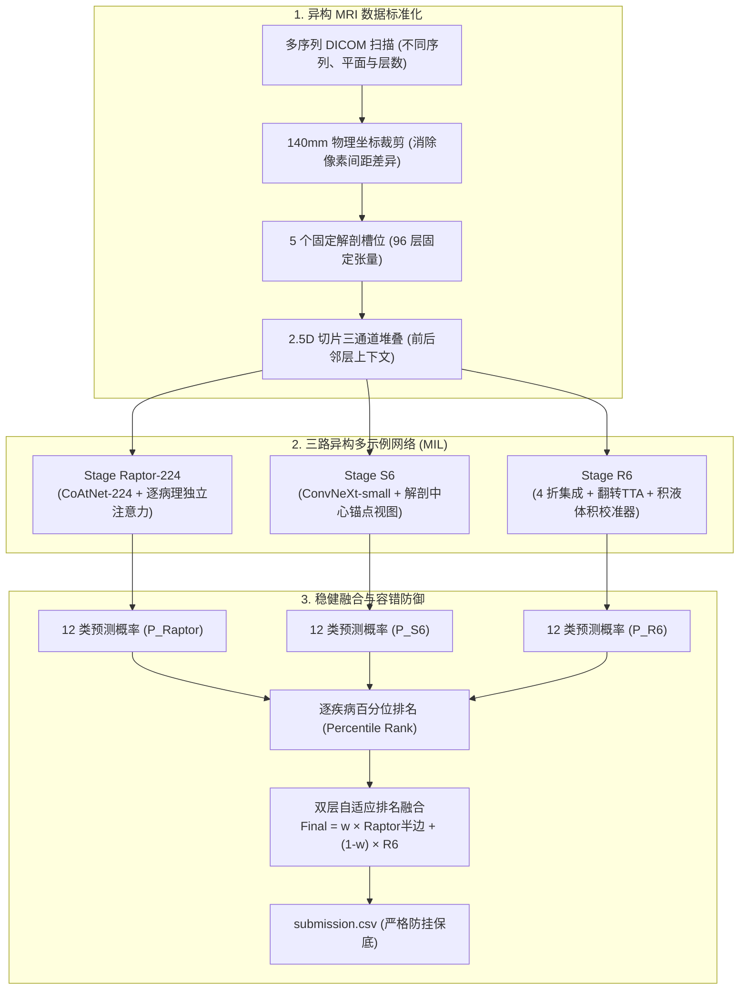

# RSNA Knee Mastery · Kaggle 银牌方案工业级复现与教学代码库

<p align="center">
  <a href="LICENSE"></a>
  
  
  
  
  <a href="#quickstart-5-second-demo"></a>
</p>

<p align="center">
  <b>端到端 2.5D 多示例学习 (MIL)、逐类别独立注意力寻径、百分位排名自适应加权融合</b><br/>
  <i>End-to-End Medical MRI Multi-Abnormality Detection: Industrial-Grade Solution & Zero-GPU Educational Walkthrough</i>
</p>

---

## 📖 目录 (Table of Contents)
- [1. 项目简介 (Overview)](#1-项目简介-overview)
- [2. 方案全景架构 (Architecture)](#2-方案全景架构-architecture)
- [3. 四大核心算法突破 (Core Algorithmic Innovations)](#3-四大核心算法突破-core-algorithmic-innovations)
- [4. 5 秒极速体验：无需 GPU 的算法 Demo (Quickstart)](#4-5-秒极速体验无需-gpu-的算法-demo-quickstart)
- [5. Kaggle 线上实战与复现指引 (Reproduction Guide)](#5-kaggle-线上实战与复现指引-reproduction-guide)
- [6. 代码库结构 (Repository Structure)](#6-代码库结构-repository-structure)
- [7. 致谢与引用 (Acknowledgements & License)](#7-致谢与引用-acknowledgements--license)

---

## 1. 项目简介 (Overview)

在医学影像诊断竞赛 **RSNA Knee Abnormality Detection** 中，算法需要对病人的膝关节多序列 MRI 扫描进行全方位分析，并同时对 **12 种病理异常** 给出精准预测：
> **12 种病理发现**：前交叉韧带撕裂 (`ACL`)、内侧副韧带损伤 (`MCL`)、内侧半月板撕裂 (`Medial Meniscus`)、外侧半月板撕裂 (`Lateral Meniscus`)、内侧骨关节炎 (`Medial OA`)、外侧骨关节炎 (`Lateral OA`)、髌股骨关节炎 (`PF OA`)、关节积液 (`Effusion`)、滑膜炎 (`Synovitis`)、贝克囊肿 (`Baker's`)、骨挫伤 (`Contusion`)、骨折 (`Fracture`)。

### 核心痛点与挑战
1. **极端弱监督 (Extreme Weak Supervision)**：在 4,407 个病例中，仅有 58 个拥有专家真标签，其余 4,349 个仅有自由文本放射报告；
2. **多序列长尾异构 (Heterogeneous MRI Series)**：不同医院、不同扫描仪的切片平面（矢状位 / 冠状位 / 轴位）、层厚与像素间距（0.3mm ~ 0.5mm）迥异；
3. **病灶极其微小且稀疏**：单张韧带损伤在原始大图上可能仅占几个像素，常规直接缩放会导致关键病灶彻底丢失。

本项目完整开源了获得 **Kaggle 银牌表现（Macro-AUC ~0.95+）** 的推理、融合与工业级防御管线，并提供了一套**纯 NumPy 编写、无需 GPU 即可运行的算法演示 Demo**。

---

## 2. 方案全景架构 (Architecture)

整体方案采用 **三路异构网络 + 逐疾病独立注意力多示例学习 + 层次百分位排名加权融合**：



---

## 3. 四大核心算法突破 (Core Algorithmic Innovations)

### 3.1 140mm 物理坐标系裁剪 vs 盲目像素缩放
- **传统做法的致命陷阱**：直接将 $512 \times 512$ 的 DICOM 图片 `resize` 到 224，只有几个像素宽的交叉韧带微小撕裂会被插值算法平滑抹杀；不同医院 0.3mm 与 0.5mm 的分辨率差异更会让模型误学到“机器型号特征”。
- **物理裁剪方案**：利用 DICOM 的 `PixelSpacing` 标签，动态计算真实物理世界中恰好为 **140.0 毫米** 的像素窗口进行精确裁剪：
  $$\text{CropPixels} = \text{round}\left(\frac{140.0}{\text{PixelSpacing}}\right)$$
  确保不同机器扫描下的成年人膝盖在模型视场中保持完全相同的真实解剖比例。

### 3.2 5 个固定解剖槽位 (Fixed Slots)
将结构任意变化的 MRI 检查规整为严格固定的 96 层输入张量：
```python
SLOTS = [
    ("Sagittal", 1, 26),   # 矢状位 · 液体敏感序列 (高亮水肿积液) -> 取 26 层
    ("Sagittal", 0, 22),   # 矢状位 · 常规解剖序列 (清晰显示骨质软骨) -> 取 22 层
    ("Coronal",  1, 18),   # 冠状位 · 液体敏感序列 -> 取 18 层
    ("Coronal",  0, 12),   # 冠状位 · 常规解剖序列 -> 取 12 层
    ("Axial",   -1, 18)    # 轴位 -> 取 18 层
]  # 合计: 26 + 22 + 18 + 12 + 18 = 96 层
```

### 3.3 逐类别独立注意力机制 (Class-Specific Attention via einsum)
不同病理在不同切面上的可见度完全不同（韧带撕裂往往只在矢状位 2~3 张切片显现，而关节炎遍布冠状位多张切片）。
- 本方案拒绝所有疾病共用一个池化特征；
- 为 12 个病理分别配备独立的注意力权重投影矩阵，利用张量爱因斯坦求和约定（`einsum`）实现各病理自主寻径：
  $$\text{PooledFeature}_{c} = \sum_{k=1}^K \text{Attention}_{k, c} \cdot \text{Feature}_{k}$$

### 3.4 百分位排名融合 (Percentile Rank Blending) 与 0.5 哨兵容错
- **为什么绝不能直接平均概率**：宏平均 AUC 指标只考察预测值在全样本集中的**相对相对排序（Ranking）**，而不是绝对数值。若一个模型偏激（0.1~0.9）、另一个模型保守（0.4~0.6），直接概率相加会导致保守模型的有效排序信息被完全覆盖。
- **哨兵隔离与平滑接管**：推理异常或损坏的病例填入哨兵值 `0.5`，并在排名阶段使用隔离过滤机制（`pct_on`），绝不让哨兵值扰动健康样本的排名。

---

## 4. 5 秒极速体验：无需 GPU 的算法 Demo (Quickstart)

代码库中内置了零依赖、纯 NumPy 实现的演示脚本 [`beginner_demo.py`](beginner_demo.py)。只需 Python 环境即可在 5 秒内亲自观察上述核心算法：

### 运行步骤
```bash
# 1. 克隆代码库
git clone https://github.com/<your-username>/rsna-knee-mastery.git
cd rsna-knee-mastery

# 2. 安装基础依赖 (仅需 numpy)
pip install -r requirements.txt

# 3. 运行交互 Demo
python3 beginner_demo.py
```

### 控制台输出预览
```text
============================================================
1. 按毫米裁剪（CROP_MM = 140）
  像素间距 0.3 mm -> 裁 467 像素 -> 再缩放到 224x224
  像素间距 0.5 mm -> 裁 280 像素 -> 再缩放到 224x224
  结论：两张图最后都是 224x224，且都正好覆盖真实的 140mm，膝盖大小一致。
============================================================
2. softmax：把任意分数变成'加起来等于 1 的权重'
  原始分数: [0.2 3.  0.1 0.5]
  softmax 权重: [0.051 0.835 0.046 0.069]  总和 = 1.0
  第 2 个窗口分数最高，所以它拿到最大权重。
============================================================
3. 每个疾病一套注意力（缩小版 RaptorClassifier.head）
  注意力权重 [窗口 x 疾病]（每一列和为 1）:
  ACL       概率 = 0.658
  Effusion  概率 = 0.314
  Fracture  概率 = 0.836
  不同疾病的注意力列不一样 -> 它们各自'看'不同的切片。
============================================================
4. 排名融合（5 个病人，某疾病的预测）
  A 原始概率: [0.9 0.8 0.3 0.2 0.1]
  B 原始概率: [0.55 0.6  0.52 0.51 0.4 ]
  A 排名    : [1.  0.8 0.6 0.4 0.2]
  B 排名    : [0.8 1.  0.6 0.4 0.2]
  若直接平均概率，B 几乎没作用；用排名就公平了（AUC 只看排序）。
  最终分数  : [0.904 0.896 0.56  0.44  0.2  ]
```

---

## 5. Kaggle 线上实战与复现指引 (Reproduction Guide)

### 完整线上 Notebook
主 Notebook [`rsna-knee-accuracy50-e8-replace-raptor384-20261020.ipynb`](rsna-knee-accuracy50-e8-replace-raptor384-20261020.ipynb) 是直接提交至 Kaggle 评测系统的完整版本。

### 模块化生产脚本 ([extracted_scripts/](extracted_scripts))
若希望在本地集群或自主训练环境中分步执行：
- [`raptor224_run.py`](extracted_scripts/raptor224_run.py)：CoAtNet-224 多切片多示例推理器，带 fp16 混合精度与 fp32 自动降级回退；
- [`s6_reference.py`](extracted_scripts/s6_reference.py)：S6 模型的推理控制器，内置看门狗超时监控与 SHA-256 离线哈希防漂移校验；
- [`notebook_pipeline.py`](extracted_scripts/notebook_pipeline.py)：完整的三阶段编排流程，包含子进程 GPU 显存隔离与 Stage 3 最终排名融合。

---

## 6. 代码库结构 (Repository Structure)

```text
rsna-knee-mastery/
├── README.md                      # 项目核心技术文档
├── LICENSE                        # MIT 开源协议
├── requirements.txt               # Python 依赖清单
├── .gitignore                     # 过滤临时文件与本地私有数据
│
├── beginner_demo.py               # 零 GPU 依赖的 NumPy 核心算法 Demo (5秒上手)
├── rsna-knee-accuracy50-e8-replace-raptor384-20261020.ipynb # 线上推理融合 Notebook
│
└── extracted_scripts/             # 模块化生产级推理与模型脚本
    ├── notebook_pipeline.py       # 端到端推理主管线
    ├── raptor224_run.py           # CoAtNet-224 多切片注意力模型
    └── s6_reference.py            # ConvNeXt-S6 解剖中心视图参考模型
```

---

## 7. 致谢与引用 (Acknowledgements & License)

- 方案基于 Kaggle [RSNA Knee Abnormality Detection](https://www.kaggle.com/competitions/rsna-knee-abnormality-detection) 竞赛规则构建；
- 弱监督报告标签源自开源社区贡献与 LLM 提取管线；
- 感谢 Osteoarthritis Initiative (OAI) 开放科研数据库对骨关节炎医学影像研究的支持；
- 本项目遵循 [MIT 许可证](LICENSE)，欢迎自由引用、学习与二次开发。
