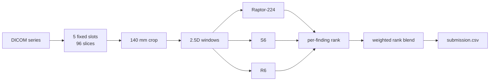

# rsna-knee-mastery

<p align="center">
  <a href="https://github.com/OWNER/rsna-knee-mastery/actions/workflows/ci.yml"></a>
  <a href="LICENSE"></a>
  
  
  
</p>

**Tested building blocks and annotated reference code for a public Kaggle pipeline that scores twelve
knee-MRI findings per study** (RSNA Knee Abnormality Detection).

[中文简介](#中文简介) · [Architecture](docs/architecture.md) · [Reproduction](docs/reproduction.md) ·
[Contributing](CONTRIBUTING.md) · [Changelog](CHANGELOG.md)

---

## What this repository is (and is not)

| Is | Is not |
|---|---|
| A **tested NumPy package** (`rsna_knee`) of the pipeline's key logic: mm-based cropping, fixed-slot slice sampling, per-finding attention, rank fusion with failure handling | A training repository — no training code, labels or weights are included |
| The **upstream reference scripts and notebook**, kept intact under `reference/` and `notebooks/` | A medical device. Research/education only |
| A zero-GPU walkthrough you can run in seconds | Original work in `reference/` — that code belongs to its Kaggle authors, see [credits](THIRD_PARTY_NOTICES.md) |

Reported public leaderboard scores (≈0.95 for the strongest components) come from comments in the upstream
notebooks and have not been re-verified here.

## Quick start

```bash
git clone https://github.com/OWNER/rsna-knee-mastery.git
cd rsna-knee-mastery
python -m venv .venv && source .venv/bin/activate
pip install -e ".[dev]"

make test     # 22 unit tests, no GPU or data needed
make demo     # annotated walkthrough of the four core ideas
```

```python
import numpy as np
from rsna_knee import FINDINGS, crop_pixels, pick_indices, fuse_all

crop_pixels(0.3), crop_pixels(0.5)      # (467, 280): both cover 140 mm
pick_indices(100, 10)                   # [2, 13, 23, ..., 97]: spans 2 %-98 % of the stack

rng = np.random.default_rng(0)
a, b, c = (rng.uniform(size=(5, 12)) for _ in range(3))   # three models' probabilities
scores = fuse_all(a, b, c, FINDINGS)    # per-finding percentile-rank blend, shape (5, 12)
```

## The four ideas

1. **Crop in millimetres** — `140 mm / PixelSpacing` pixels, so a knee fills the same fraction of the frame
   at 0.3 mm and 0.5 mm spacing. → [`geometry.py`](src/rsna_knee/geometry.py)
2. **Five fixed slots (96 slices)** and **2 %–98 %** sampling — fixed-size input from studies with varying
   series and slice counts, without discarding the outer slices. → [`slots.py`](src/rsna_knee/slots.py)
3. **Per-finding attention** — each of the 12 findings learns which windows matter for it.
   → [`attention.py`](src/rsna_knee/attention.py)
4. **Percentile-rank fusion** — macro-AUC only cares about ordering, so models are blended by rank, each
   ranked over its own non-failed studies; a failed study takes the other model's rank.
   → [`fusion.py`](src/rsna_knee/fusion.py)



More detail, including every design decision and where it lives in the code: [docs/architecture.md](docs/architecture.md).

## Repository layout

```text
src/rsna_knee/     tested package (NumPy only)
tests/             pytest suite
examples/          zero-GPU demo
reference/         upstream pipeline scripts (not MIT — see THIRD_PARTY_NOTICES.md)
notebooks/         upstream Kaggle inference notebook
docs/              architecture + reproduction guide
```

## Reproducing the Kaggle run

Needs a Kaggle T4 notebook, competition access, and the exact weight datasets (SHA-256 verified).
Step by step in [docs/reproduction.md](docs/reproduction.md).

## Contributing

Issues and PRs welcome — start with [CONTRIBUTING.md](CONTRIBUTING.md). Please never submit patient data,
competition data, weights, or credentials.

## License and credits

Original code (`src/`, `tests/`, `examples/`, `docs/`): [MIT](LICENSE). Upstream code in `reference/` and
`notebooks/` keeps its authors' terms; full attribution and a data-use acknowledgement (OAI/NDA) are in
[THIRD_PARTY_NOTICES.md](THIRD_PARTY_NOTICES.md).

---

## 中文简介

这是对一个 **Kaggle RSNA 膝关节 MRI（12 项发现）公开方案** 的整理：

- `src/rsna_knee`：把方案里最关键的逻辑（**按毫米裁剪**、**5 个固定槽位 96 层 + 2%–98% 取片**、**逐疾病注意力**、
  **百分位排名融合与失败样本接管**）用 NumPy 重新实现，并配有单元测试，**无需 GPU 与数据**即可运行；
- `reference/`、`notebooks/`：保留原作者的推理脚本与 Notebook（**版权属于原作者**，见 [THIRD_PARTY_NOTICES.md](THIRD_PARTY_NOTICES.md)）；
- 不包含训练代码、标签与权重；公开榜约 0.95 的分数来自上游注释，未在此复核。

快速开始：`pip install -e ".[dev]" && make test && make demo`。
