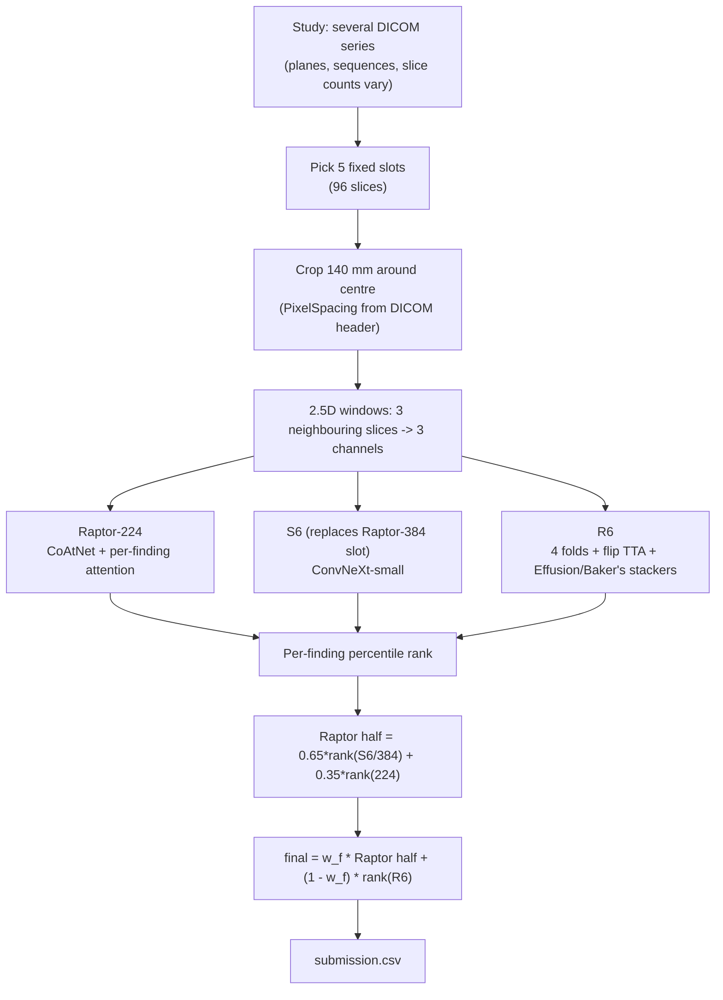

# Architecture

This page describes the pipeline implemented by the reference code in [`reference/`](../reference) and
the notebook in [`notebooks/`](../notebooks). Everything below is read from that code; where something
is *not* in the code (e.g. the training recipe) it is marked as such.

## What the code is

An **inference + fusion** pipeline. Trained weights are loaded, three model families score each
study for twelve findings, and a per-finding percentile-rank blend produces `submission.csv`.
There is **no training loop** in this repository.

## Data flow

## Design decisions

| Decision | Why | Where |
|---|---|---|
| Crop in **millimetres** | A knee should fill the same fraction of the frame at 0.3 mm and 0.5 mm spacing | `rsna_knee.geometry` |
| **5 fixed slots**, 96 slices | Studies have different series/slice counts; the network needs a fixed input | `rsna_knee.constants.SLOTS` |
| Sample **2 %–98 %** of a stack | The outer slices hold the collateral ligaments / lateral meniscus | `rsna_knee.slots` |
| **Per-finding attention** | Different findings are visible on different slices | `rsna_knee.attention` |
| **Rank** blend, not probability mean | Macro-AUC depends only on ordering; models differ in calibration | `rsna_knee.fusion` |
| Rank over **non-failed rows only** | A sentinel/mean-filled row must not shift healthy rows' ranks | `fusion.pct_rank_on` |
| Failed study takes the other model's rank | Never drop a study from the submission | `fusion.fuse_finding` |
| Subprocess per model, SHA-256 checks | Isolate GPU memory; guarantee the exact weights/code are used offline | `reference/s6_reference.py` |

## Weak labels (from upstream comments, not reproduced here)

Only 58 of 4,407 studies carry structured labels. The upstream weights were trained on soft labels
extracted from radiology reports by a language model (e.g. "suspected tear" ≈ 0.8). The 58 gold
studies were held out for validation. The labels and the training code are **not** part of this repo.

## Fusion weights

From `W_RAPTOR_C` in `reference/notebook_pipeline.py`: Raptor weight is 0.5 by default; Lateral OA 0.2,
PF OA 0.6, Synovitis 0.8, Baker's 0.35. The upstream notes say these were fixed by hand rather than
fitted on a clean labelled set, so treat them as hyper-parameters of that submission, not as general
truths.
